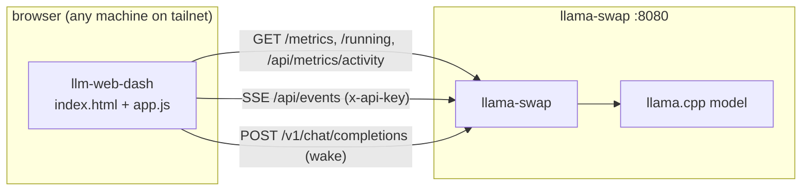

<p align="center">
  
</p>

<h1 align="center">llm-web-dash</h1>

<p align="center">
  <b>A tiny, dependency-free web dashboard to watch llama-swap / llama-cpp model state on a GPU box over the network — meant to live on a NAS.</b>
</p>

<p align="center">
  
  
  
  
  
  
</p>

---

## What this is

A single-page dashboard that monitors a llama-swap server from any browser, with nothing to install:

- **Hardware** — VRAM, system RAM, GPU model, GPU utilization, CPU utilization, GPU temperature, GPU power draw — loaded *live* from Prometheus `/metrics`
- **Throughput** — generation and prompt tokens/s, with a 60-second rolling chart
- **Models** — state (loaded / starting / idle / stopped), Wake / Unload actions
- **Queue** — models currently starting up
- **Recent requests** — model, status, in/out tokens, latency, throughput

It's vanilla HTML/CSS/JS. No build step, no npm, no framework. Drop the files on any static host (a NAS, a folder, `python -m http.server`) and point it at a llama-swap URL.

## Why

llama-swap ships a dashboard, but it's built for the operator who's standing at the server. This one is built for the person watching from another machine over Tailscale — a glance at a panel to answer "is it awake, how hot, how fast, what's queued" without opening the API.

Everything is read-only by default. The only writes are the two buttons: **Wake** sends a throwaway tiny completion (llama-swap has no dedicated load endpoint — a model wakes on its first inference request), and **Unload** frees the model.

## Tested on

The dashboard talks to the real llama-swap `/metrics` format. Parse correctness is verified against a captured `/metrics` sample from a production box (see `test/parse.test.js` against `test/fixtures/`):

| | |
|---|---|
| GPU | NVIDIA GeForce RTX 3080, 10 GB |
| GPU temp | 56 °C |
| GPU power | 223.75 W |
| CPU | 16-core machine, averaged across all cores |
| Memory | 32 GB DDR4 |
| OS | Windows 11, over Tailscale |
| Software | llama-swap v2.69.0 |

The **UI** was exercised against a mock (`mock-llama.js`) — GPU/vRAM/throughput values there are fabricated for local testing. The **parse layer** (`parseMetrics`) is verified against a real captured `/metrics`. The dashboard is not yet deployed to the production NAS.

## How it works



The dashboard reads `config.json` at startup (host, API key, poll interval in ms), then `localStorage` for user overrides. Editing `config.json` directly is enough to set the host and key; the UI also lets you type everything manually and press **Connect**.

```json
{ "host": "http://nas:8080", "apiKey": "", "pollMs": 3000 }
```

## llama-swap endpoints used

| Panel | Endpoint |
|-------|----------|
| Hardware | `GET /metrics` (Prometheus, live load) |
| Model state | `GET /running` |
| Throughput / requests | `GET /api/metrics/activity?limit=50` |
| Model list (live) | `GET /api/events` (SSE) |
| Version | `GET /api/version` |
| Wake | `POST /v1/chat/completions` (first request triggers the swap) |
| Unload | `POST /api/models/unload/{model}` |

## Security

> The dashboard runs in the browser. `config.json` is read client-side, the API key is
> stored in `localStorage`, and sent in the `x-api-key` header on every request. Anyone who
> visits the site (or knows the NAS URL) can read the JSON and the `localStorage` — the key
> is in plaintext. Use a dedicated key scoped to the llama-swap API, and revoke it if exposed.

Keep the dashboard behind Tailscale or another network boundary. Don't expose port 8080 to the internet.

## Test with the mock

`mock-llama.js` serves a fake llama-swap API so you can try the dashboard without a real machine:

```sh
node mock-llama.js index.html
# then open http://localhost:8123/ and enter http://localhost:8123 in the host field
```

Run the parse test against a real captured `/metrics` sample:

```sh
node test/parse.test.js
```

## Repository layout

```
index.html                 dashboard shell (ink-dark, cyan accent)
app.js                    data fetching, parsing, rendering, actions
mock-llama.js             fake llama-swap server for local testing
test/parse.test.js        parseMetrics() against real /metrics fixture
test/fixtures/            captured /metrics sample (production box)
config.example.json       config template (config.json is gitignored)
logo.svg                  brand mark
LICENSE                     MIT
```

## Limitations

- **Wake is untested in production** — it relies on llama-swap waking a model on its first request.
- The dashboard is not yet deployed to the production NAS; the server serves its own UI.
- The GPU power figure is for the single GPU the dashboard selects (the one with dedicated VRAM), not a sum across cards.

## License

[MIT](LICENSE). llama-swap and llama.cpp keep their own licenses.
